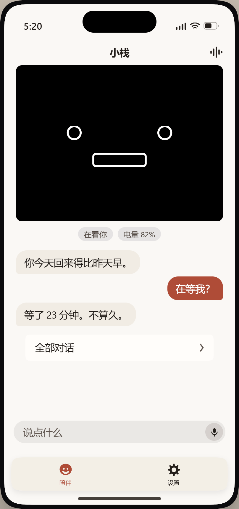
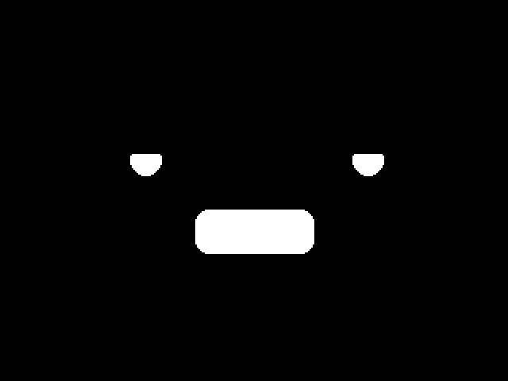

# StackChan Companion

> 一个**开源、自研**的桌面 AI 陪伴机器人软件栈 + 原生 iOS App。
> 硬件用官方成品 **M5Stack StackChan**，**软件、交互、账号、AI 供应商全部自研**。

<p align="center">
  
</p>

<p align="center"><sub>4 套视觉方案 · 全部为 iOS 原型<b>真实渲染</b>（Playwright 点方案切换器后截图，非示意图）· 强调色与对比度均为实算值 · 素材为 2× 截图（808×1716），此处按原生 CSS 尺寸 404 显示以免放大糊掉</sub></p>

> ⚠️ **本项目是社区第三方项目，与 M5Stack 无隶属关系。**
> "StackChan" 是 **M5Stack Technology CO LTD** 的商标。本仓库不使用其商标作为自身标识，
> 也不复制其产品形象（App 图标为自有的抽象符号）。
> 详见 [`LICENSE`](LICENSE)、[`NOTICE`](NOTICE) 与 [`docs/research/33-许可与商标边界.md`](docs/research/33-许可与商标边界.md)。

---

## 一句话产品主张

> 屏幕上唯一会动、唯一被注视的东西是小栈的脸；其他一切都是背景。

---

## ⭐ 60 秒看到核心能力

**「韵律 → 身体」**：把 AI 说话的**语音韵律**编译成设备的**舵机姿态 + 表情参数**，设备真的跟着语气动。

<p align="center">
  
</p>

<p align="center"><sub>上图每一帧都是<b>真实关键帧</b>渲染的：真实 MiniMax TTS → 韵律提取 → 42 参数 → 0x14 关键帧 → 固件几何（眼直径 <code>map_range(size,-100,100,8,32)</code>、眼睑 <code>-map_range(weight,0,100,0,眼径)</code>、嘴 <code>map_range(w,0,100,90,60)</code>）→ 320×240 像素。生成器：<code>tools/make_readme_hero.py</code>。</sub></p>

```bash
py -3.12 tools/demo_offline.py --text "今天真开心啊！"
```

这条命令会跑完整条链路，并把设备脸上的表情**画在终端里**：

```
  [t=  0.00s] eyeW=100 mouthW= 36 yaw=   14 pitch= 756
    ┌──────────────────────────┐
    │        ●         ●       │
    │            ◡             │
    └──────────────────────────┘
```

无需密钥、不联网。有 MiniMax key 的话加 `--tts` 就用**真实 TTS 音频**跑同一条链路。

```
文本 ─▶ 音频 ─▶ 韵律 7 维 ─▶ 42 标量 ─▶ 0x14 关键帧 ─▶ WS 帧 ─▶ 设备侧解析 ─▶ 脸
```

| 环节 | 实现 | 关键事实 |
|---|---|---|
| 韵律提取 | `tools/prosody_to_motion.py` | YIN 基频 + 能量 + HNR + 谱质心 + VAD，100 Hz 分析窗 |
| 关键帧编译 | 同上 | 语义锚点 + PCHIP 插值 → 25 fps / `durationMs=40` |
| 协议封帧 | `tools/stackchan_server.py` | `[Type(1)][Length(4 BE)][Payload]` |
| 设备侧解析 | `tools/protocol_sim.py` | 复刻固件 `payload(msg.data.begin() + 5, …)` 行为 |
| 真实 BLE 驱动 | `tools/stackchan_ble.py` | NimBLE GATT 六个 UUID，载荷契约逐条取自固件源码 |
| 音画同源校验 | `tools/demo_offline.py` | 关键帧与音频来自同一段 PCM ⇒ 对齐误差 **≤ 一帧（40 ms）** |
| 音画对齐端到端闭环 | `tools/tts_align_e2e.py` | 真实 TTS → 关键帧 → 切片 ⇒ 对账误差 **0 ms**、字节拼回 == 原 PCM |
| 音频按帧栅格切片 | `tools/audio_chunk.py` | 关键帧驱动切法 ⇒ 真实 TTS（非 40 ms 整数倍）上误差 **0 ms** |
| **真实 API 全链路** | `server/run.py --demo --provider minimax` | 真实 Chat（ENFP 人格）→ 真实 TTS → 韵律 → 42 参数 → PCHIP → `0x14` → WS → 设备模拟器，**退出码 0**；原始日志与逐条手算复算见 [`docs/research/75`](docs/research/75-真实MiniMax端到端闭环实测与TTS不可复现性.md) |
| ⭐ **TTS 不可复现 ⇒ 关键帧不能预烘焙** | 同上 | 同一段文本同音色连跑 3 次，音频 **4.598 / 5.759 / 6.095 s**（极差 **+32.6%**）、LLM 回复文本每次都不一样 ⇒ 关键帧必须按**本次 PCM** 实时编译 |
| ⭐ **三段延迟实测** | `tools/bench_latency.py` | 真实 MiniMax API，LLM / TTS / 关键帧编译三段分开计时（口径 = **服务端侧下界**）：LLM p50 2019 ms + TTS p50 1098 ms + **我们的编译 p50 103 ms** ⇒ 合计 p50 **3220 ms**、max **5065 ms** ⇒ 💥 **我们自己的 M1 判据「开始出声 < 2.5 s」实测不达标**，瓶颈在**上游 API** 而非我们的算法；见 [`docs/research/77`](docs/research/77-延迟实测与M1判据不达标.md) |
| 全链路 Demo | `tools/demo_offline.py` | 31 项断言自检 |

---

## 官方 vs 我们

官方 StackChan 的硬件与表情引擎很好，但软件栈是**封闭的商业后端 + Flutter App**。
我们保留硬件、表情引擎、舵机/触摸 HAL、渲染层，替换掉账号体系、入口、AI 供应商与全部交互。

| 层 | 官方 | 我们 |
|---|---|---|
| 硬件 | 官方成品 | **同款，不改 PCB、不改结构** |
| 固件 HAL / 表情引擎 / 舵机 / 触摸 / 渲染 | 官方 | **保留，只读不 fork**，仅在协议层对接 |
| 账号体系 | 官方 + 小智工厂服务 | **自建**（通用引擎 + 通用人格包开源，个人数据永不入库） |
| AI 供应商 | 小智（XiaoZhi） | **MiniMax**（Chat + TTS） |
| 手机端 | Flutter 1.2.8 | **原生 SwiftUI，从零重写** |
| 谁出声 | **手机**（App 侧 `AVAudioEngine`） | **同款**：手机出声，设备做身体 ⭐ |

> ⭐ 最后一行的「同款」不是偷懒，是**取证结论**：官方固件（1.5.1 / 1.6.0）的
> `DataType::Opus` 分支**整段被注释**，`0x18/0x19` 是**空 case**，
> 且它引用的 `AudioStreamPacket` / `_audio_service` **在整个固件树里无定义**
> ⇒ **官方固件根本没有「服务器 → 设备」的音频通道**，官方的声音也是在手机上播的。
> 详见 [`docs/research/64-固件音频通道取证与谁出声架构裁决.md`](docs/research/64-固件音频通道取证与谁出声架构裁决.md)。

---

## 这个仓库的独特之处

**① 设备即档案。** App 里显示的脸不是另一套美术，而是**设备此刻真实的那张脸**——
同一套参数、同一套几何公式，两端**几何一致**（中心点 / 直径 / 旋转角 / 眼睑偏移 / 层级 / 设备原色；
⚠️ 逐像素一致**只对未旋转元素成立** —— 固件的眼睛会大幅旋转，而设备（LVGL）与 App（SwiftUI）
**都做抗锯齿光栅化** ⇒ 旋转后的眼睛不可能逐像素相同，依据见 [`docs/spec/06` §9.2b.1](docs/spec/06-表情参数模型.md)）。
这让"陪伴"有了可审计的物理来源，而不是一个会动的贴图。

**② 整个生态里只有我们做「韵律 → 身体」。** 三件套全在服务端：
保活调度器、关键帧编译器、插值器。竞品要么把 AI 放云端只传文字/音频，
要么在设备上跑小模型但没有身体表达。

**③ 全部结论带出处。** `docs/research/` 里 98 份取证档案（约 5.6 MB），
每条结论都能追到 `file:line` 或实测记录；被推翻的假设也留着，并写明为什么错。

**④ ⭐ 我们测出了一个别人不会写进 README 的事实：TTS 的输出不可复现。**
同一段文本、同一音色、连跑 3 次，真实 MiniMax 返回的音频时长是 **4.598 / 5.759 / 6.095 s**（极差 **+32.6%**），
LLM 的回复文本**每次都不一样**。
⇒ 所以**关键帧不能预烘焙**：任何「先算好动作再播固定音频」的方案都会在真实链路上音画错位。
我们把整条链路绑死在「**这一份 PCM 的时间轴**」上 —— 切音频用关键帧栅格切（`tools/audio_chunk.py`），
对账误差 **0 ms**、字节拼回 == 原 PCM。
见 [`docs/research/75-真实MiniMax端到端闭环实测与TTS不可复现性.md`](docs/research/75-真实MiniMax端到端闭环实测与TTS不可复现性.md)
（含原始日志与逐条手算复算）。

**⑤ 我们拿自己的判据量自己，量出不合格就写在 README 里。**
`tools/bench_latency.py` 把「文字进 → 关键帧可下发」拆成 LLM / TTS / 编译三段分别计时：
LLM p50 **2019 ms**、TTS p50 **1098 ms**、**我们的关键帧编译器 p50 103 ms**（只占 **1.5%–9%**）。
合计 p50 **3220 ms** ⇒ **M1 的「开始出声 < 2.5 s」判据实测不达标**。
⇒ 这条结论指向的是**上游 API**（流式首句先行 / 流式 TTS / 限制回复长度），
**不是**「把我们的编译器再优化快一点」——后者最多省 0.1 s，方向就错了。
我们把它登记为待拍板项 **Q16**，并写清「优化路径依赖音频承载方式（Q10）」的耦合关系。
见 [`docs/research/77-延迟实测与M1判据不达标.md`](docs/research/77-延迟实测与M1判据不达标.md)。

**⑤ 「像不像 iOS」交给机器判。** `prototype/ios/check_ios.py` 把 iOS 原生感拆成
**36 项原生特征 + 11 类 Android 味黑名单 + 5 条 T1 官方硬指标**，
每条结论都带 Apple 官方文档出处与**出处等级**（T1 官方明文 / T4 自研设定）——
连「哪些数值是 Apple 官方给的、哪些是我们自己定的」都分得清清楚楚。
见 [`docs/spec/08-iOS官方规范事实层.md`](docs/spec/08-iOS官方规范事实层.md)。

---

## 当前状态

**已实现并自测通过**：

- ✅ 韵律 → 关键帧编译器（42 项自检）
- ✅ 云端 WS 服务端（67 项自检，含 5 个变异用例）
- ✅ BLE 直连驱动（22 项自检；载荷契约逐条取自固件源码）
- ✅ 真机 BLE 一键验收脚本（32 项自检；设备不在 DANCE 时**优雅降级**，不假装成功）
- ✅ 0x14 分段下发器（26 项自检；固件对连续 0x14 是**替换**语义，必须分段 + 定时调度）
- ✅ 协议模拟器（设备侧 + App 侧双向，含 0x14 关键帧全链路）
- ✅ 全链路 Demo（**31** 项断言，含**音画对齐 ≤ 一帧**）
- ✅ PCM 音频切片器（**49** 项断言；关键帧驱动切法，真实 TTS 音频上误差 0 ms）
- ✅ 音画对齐端到端闭环（`tools/tts_align_e2e.py`；真实 MiniMax TTS 1358 ms → 34 帧 → 误差 **0 ms**）
- ✅ 韵律→身体 **离线标定体检**（`tools/check_prosody.py`；10 项判据 + 6 项自检：情绪淹没比 / 6 情绪可辨识度 / 边界伪影 / 逐字节可复现 / 单调性 / 带宽 / 越界）
- ✅ 后端基座（`server/`，MiniMax provider + 人格 + 记忆 + 离线闭环，67 项测试）
- ✅ iOS 协议包 + 完整 App 工程（`ios/`，43 个 Swift 文件）
- ✅ iOS 原生感判定器 + 官方规范事实层（`prototype/ios/check_ios.py`、`docs/spec/08`）

**真机取证**（只读，未写 flash）：

- ✅ 固件 1.5.1 与 1.6.0 的 BLE / JSON / app_dance **逐字节相同**
- ✅ 1.5.1 编译期指向 `http://47.113.125.164:12800`，**无运行期覆盖** ⇒ 云通道需重编译固件
- ✅ BLE 外设只在 DANCE 应用打开时启动 ⇒ 真机停在 Launcher 欢迎页时不广播
- ✅ **官方固件没有服务器→设备音频通道**（Opus 分支注释、0x18/0x19 空 case）⇒ 架构裁决为「手机出声，设备做身体」
- ⛔ 1.5.1 **没有局域网直连**（二进制检索 + 源码树双重验证）

**未验证 / 待拍板**：

| 项 | 状态 |
|---|---|
| Swift 编译 / xcodebuild / 单测实跑 | ⚠️ **本机无 Mac**，只能靠 GitHub Actions macOS runner（CI 已配置，**未跑过**） |
| 真机 BLE 实测 | ⛔ 需用户手动点两下（Skip → DANCE）后才能跑 |
| 视觉方向 / 强调色 / App 定位 / 脸怎么画 | ⛔ **未拍板**，见 [`docs/spec/07-待拍板清单与防返工机制.md`](docs/spec/07-待拍板清单与防返工机制.md) |
| App↔云的音频承载方式 | ⛔ 待拍板（3 选 1，推荐 WS 分片；见 `docs/spec/07` §3.6） |
| 固件基线取 1.5.1 还是 1.6.0 | ⛔ 待拍板 |

> 诚实的原则：**没测过的写「未验证」，不把「没测」写成「通过」。**

---

## 仓库分区

每个目录只放一类东西，职责不重叠：

```
StackChanCompanion/
├── PRODUCT.md              产品真相层：受众 / 目的 / 场景 / 不做什么 / 证据 / 失败信号
├── DESIGN.md               视觉系统层：色彩 / 排版 / 间距 / 形状 / 动效预算 / 禁止清单
├── README.md               你在这里
├── LICENSE  NOTICE         MIT（含上游 MIT 派生声明）+ 第三方署名
│
├── docs/
│   ├── spec/               ⭐ 产品与技术规格书（00~09）
│   │                       00 产品规格 · 01 功能取舍 · 02 质感规范 · 03 通信链路
│   │                       04 护城河 · 05 技术选型 · 06 表情参数模型 · 07 待拍板清单
│   │                       08 iOS 官方规范事实层（带出处等级）
│   │                       09 施工顺序与决策依赖图（先做什么 / 谁卡谁）
│   ├── research/           ⭐ 取证档案（98 份 / 约 5.6 MB，全部为实测取证）
│   ├── requirements/       需求与功能清单（待建）
│   ├── design/             设计规范：令牌 / 组件 / 图标（待建）
│   ├── architecture/       架构与数据流（待建）
│   └── adr/                架构决策记录，一条决策一个文件（待建）
│
├── tools/                  ⭐ 可运行的验证工具（Python 3.12）
│   ├── prosody_to_motion.py   韵律 → 关键帧编译器
│   ├── stackchan_server.py    云端 WS 服务端
│   ├── stackchan_ble.py       真机 BLE 驱动
│   ├── protocol_sim.py        协议模拟器（设备侧 / App 侧）
│   ├── demo_offline.py        一条命令跑通全链路 + 终端画脸
│   ├── dance_chunk.py         0x14 分段下发器（载荷上限 + 定时调度）
│   ├── audio_chunk.py         PCM 按帧栅格切片（与 0x14 关键帧同源对齐）
│   ├── tts_align_e2e.py       音画对齐端到端闭环（TTS → 关键帧 → 切片 → 对账）
│   ├── ble_acceptance.py      真机 BLE 一键验收（8 阶段）
│   ├── repo_release_check.py  发布前体检器
│   └── check_docs.py          文档格式体检
│
├── server/                 自建后端（Python 基座）：providers / bridge / 人格 / 记忆
├── ios/                    原生 SwiftUI App（CoreProtocol 协议包）
├── prototype/              交互原型（iOS 原生原型在 `prototype/ios/`）
├── firmware/               对官方固件的引用说明（**不 fork、不改上游**）
├── personas/               通用人格包（开源，可社区 fork）
├── assets/                 品牌与美术资产（开源部分）
└── private/                ⭐ 个人定制数据 —— 永不入库
```

**几条硬规矩**：

1. **`private/` 永不入库**（`.gitignore` 已强制）。通用引擎与通用人格包开源，**个人定制数据永不入库**。
2. **`assets/` 只放开源资产**。美术资源不进库；语义标签留在 `personas/`。
3. **研究档案与产品文档分开**。`docs/research/` 是**取证过程**，`PRODUCT.md` / `DESIGN.md` 是**结论**。
4. **`.gitignore` 是隐私边界的一部分**，不是可选的清洁工作。
5. **官方固件只读不 fork**；官方表情引擎原样使用并保留原始署名。

---

## 文档入口

| 想知道的 | 读 |
|---|---|
| **还没定的事（别急着做）** | ⭐ [`docs/spec/07-待拍板清单与防返工机制.md`](docs/spec/07-待拍板清单与防返工机制.md) |
| 要做哪些功能、UI 要承载什么、用什么技术 | ⭐ [`docs/spec/00-StackChan产品规格与技术规格.md`](docs/spec/00-StackChan产品规格与技术规格.md) |
| 表情参数怎么定义 | [`docs/spec/06-表情参数模型.md`](docs/spec/06-表情参数模型.md) |
| 通信链路与真机现实约束 | [`docs/spec/03-通信链路预设与数据契约.md`](docs/spec/03-通信链路预设与数据契约.md) §1.5 |
| **iOS 官方规范（哪些数值是官方给的）** | ⭐ [`docs/spec/08-iOS官方规范事实层.md`](docs/spec/08-iOS官方规范事实层.md) |
| **为什么设备不出声、声音从哪来** | ⭐ [`docs/research/64-固件音频通道取证与谁出声架构裁决.md`](docs/research/64-固件音频通道取证与谁出声架构裁决.md) |
| **先做什么、谁卡谁、哪些不用等拍板** | ⭐ [`docs/spec/09-施工顺序与决策依赖图.md`](docs/spec/09-施工顺序与决策依赖图.md) |
| 护城河与技术实力怎么分层 | [`docs/spec/04-产品战略与护城河总纲.md`](docs/spec/04-产品战略与护城河总纲.md) |
| 这产品是给谁做的、不做什么 | [`PRODUCT.md`](PRODUCT.md) |
| 界面长什么样、什么绝对禁止 | [`DESIGN.md`](DESIGN.md) |
| 全部结论与依据 | [`docs/research/00-总纲`](docs/research/00-总纲-设计情报总汇与方向裁决.md) |
| 我们的取证档案 | [`docs/research/README.md`](docs/research/README.md) |

---

## 本地跑起来

```bash
# 需要 Python 3.12
py -3.12 -m pip install -r tools/requirements.txt

# 各个工具的自检
py -3.12 tools/prosody_to_motion.py --self-test    # 42 项
py -3.12 tools/stackchan_server.py --self-test     # 67 项
py -3.12 tools/stackchan_ble.py selftest           # 22 项
py -3.12 tools/dance_chunk.py --self-test          # 26 项
py -3.12 tools/ble_acceptance.py --self-test       # 32 项
py -3.12 tools/demo_offline.py --self-test         # 31 项
py -3.12 tools/audio_chunk.py --self-test          # 49 项
py -3.12 tools/tts_align_e2e.py --provider stub    # 音画对齐端到端闭环
py -3.12 tools/repo_release_check.py --self-test   # 5 项
py -3.12 tools/check_prosody.py --root .           # 韵律标定体检（10 项判据）

# 跑一遍全链路
py -3.12 tools/demo_offline.py --text "今天真开心啊！"

# 后端测试 / 文档体检 / 发布前体检
py -3.12 server/run_tests.py
py -3.12 tools/check_docs.py
py -3.12 tools/repo_release_check.py --root .
```

**CI**（`.github/workflows/`）：

| workflow | 跑什么 | 需要什么 |
|---|---|---|
| `ci.yml` | 后端测试 + 工具自检 + 文档/发布体检 + iOS 静态校验 | 只要 Python，**任何平台都能跑** |
| `ios.yml` | `xcodegen` 生成工程 + `xcodebuild` 编译 + `swift test` + App Icon 流水线 | **需要 macOS runner** |

⚠️ 两个 workflow **在本机从未真跑过**（本机无 Swift 工具链），第一次真跑在 GitHub Actions 上。

---

## 许可与致谢

本仓库以 **MIT** 发布。派生自 **MIT** 许可的
[`m5stack/StackChan`](https://github.com/m5stack/StackChan)（Copyright © 2026 M5Stack Technology CO LTD）。

完整的第三方署名见 [`NOTICE`](NOTICE)，许可与商标边界分析见
[`docs/research/33-许可与商标边界.md`](docs/research/33-许可与商标边界.md)。

> ⚠️ 本仓库**不包含** AGPL-3.0 项目的代码。AGPL 项目仅作公开设计参考，实现均独立编写。

---

*Copyright © 2026 StackChan Companion Contributors.*
*StackChan 是 M5Stack Technology CO LTD 的商标。本项目为社区第三方项目，未获其背书。*
