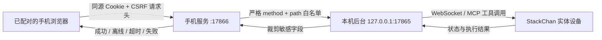

# StackChan Mobile App Design Contract

## Product intent

这是一套给依婵日常使用、也方便蒋磊远程维护的 StackChan 手机伴侣。v26 将实体屏幕、手机控制和 AI 对话视为同一产品：页面要安静、直接、可信，不展示后台或设备没有提供的状态，也不为了贴满设计稿而增加虚构开关。

## Source of truth

- 五个主栏目：首页、小栈屏幕、对话、更新、设置。遥控与测试保留为“小栈屏幕”里的二级设备工具。
- 手机服务固定使用 `17866`；设备控制服务固定使用 `17865`，两者不可互换。
- 视觉参考位于 `mobile_app/design_references/settings/`。参考图决定视觉语言和信息层级，不自动等于真实产品能力。
- 真实设备能力以 `stackchan_ai/app.py` 中的 `/gui/*` 路由为准。
- 实体屏幕应用以固件实际安装的 Mooncake app name 为准：AI Chat、小栈悄悄话、相册、心情日记、番茄钟、今日运势、游戏专区、系统设置。
- AI Chat 只能经 `/mobile-api/chat` 调用本机模型路由；模型凭据、供应商地址和完整记忆不得进入浏览器代码。
- 后台当前不提供小栈电量、当前 LED 颜色或当前屏幕亮度。这些值必须显示为“未上报”或“设定值”，不能伪装成实时读值。
- 后台提供最后确认下发的头部目标 `head={yaw,pitch,speed,source,updated_at}`，供桌面端与手机端同步预览；在固件没有舵机角度回读前，`source=commanded` 只代表已接受目标，不代表实体已经到位。

## Navigation and ownership

| Entry | Destination | Unique responsibility | Deliberately excluded |
| --- | --- | --- | --- |
| 小栈屏幕 | 屏幕工作台 | 展示并远程打开实体屏幕的八个真实应用 | 虚构应用、设备离线时假成功 |
| 对话 | AI Chat | 使用独立手机会话与个性化模型进行多轮对话 | 前端模型密钥、静态假回复 |
| 遥控头部 | 屏幕工作台二级工具 | 3D 预览、摇杆、俯仰和速度 | 主导航占位 |
| 功能测试 | 屏幕工作台二级工具 | 动作、亮度、扬声器和内置测试音 | 主导航占位 |
| 设备卡片 | 设备详情 | 连接、网络、已上报能力与无线更新支持摘要 | 假电量、控制项 |
| 陪伴方式 | 陪伴方式 | 称呼、陪伴风格、活泼程度 | 重复的“活泼程度”独立页 |
| 声音与语气 | 声音与语气 | 数据驱动的长下拉列表和当前能力说明 | 假装已切换设备声音 |
| 自动回应 | 自动回应 | 自动环顾、人物跟随、思考提示 | 摄像头权限、灯光 |
| Wi-Fi 与网络 | Wi-Fi 与网络 | 当前网络与附近网络扫描 | 手机连接网络、输入密码、热点配网 |
| 屏幕与亮度 | 屏幕与亮度 | 屏幕亮度设定 | 遥控页重复亮度 |
| 测试 | 测试主栏目 | 动作、屏幕亮度、扬声器音量和固定内置测试音 | 音乐库、任意音频路径、诊断工具 |
| 更新 | 更新主栏目 | 检查签名整机版本、准备四组件并从手机二次确认安装 | 手机上传、任意网址、单组件拼装更新 |
| 对话与记忆 | 对话与记忆 | 记忆分类、删除单项、按分类清空 | 重复称呼与个性配置 |
| 使用帮助 | 使用帮助 | 五个栏目的简短操作说明 | 虚构客服或外链 |
| 关于小栈 | 关于小栈 | 真实版本、设备说明、署名 | 重复设备诊断 |

详情页覆盖主栏目内容并隐藏底部五栏；返回后恢复设置列表及其滚动位置。所有可点击行必须打开页面或执行真实操作，不能用“稍后开放”的 Toast 代替。

## Data and trust boundary



- 手机首次用一次性配对链接换取 `HttpOnly; SameSite=Strict` Cookie；不启用 CORS。
- `/mobile-api/*` 只转发固定上游 `127.0.0.1:17865`，不接受客户端提供的主机、协议或路径。
- 写操作要求同源 `Origin` 和 `X-StackChan-CSRF: 1`。
- 普通 JSON 请求限制为 16 KiB，不记录 Wi-Fi 密码、对话、记忆内容或配对令牌。
- 不代理固件/音乐上传、关机、通用工具、诊断套件和任意 `/gui/*` 路径；扬声器测试只接受固定内置声音 ID。
- 更新安装不自动重试，准备和安装各自要求两次点击及独立确认头；清除记忆必须由用户二次确认。

## Interaction states

每个真实控件采用同一状态机：

1. `loading`：读取后台，保留骨架或“正在读取”。
2. `ready`：展示后台确认值；没有读值能力时明确标注“未上报”。
3. `sending`：控件暂时不可重复提交，显示“正在发送”。
4. `confirmed`：只在后台返回成功后更新摘要，并给出短确认。
5. `offline`：设备离线时保留页面但禁用硬件动作，说明需要先连接。
6. `failed`：恢复上一个后台确认值，展示可读错误，不制造成功反馈。

头部控制最多每 100 ms 发送一次，只保留最新目标；亮度、音量和灯光在操作结束后发送，失败时恢复上一个确认值。

## Visual system

- 背景使用近黑蓝灰，表面只比背景亮一级；主文字为柔和浅灰白，辅助文字为冷中性灰。
- 淡蓝用于当前选中、主要操作和键盘焦点；克制的玫瑰色只用于关怀或错误，绿色只表示真实成功或在线。
- 间距使用 `4 / 8 / 12 / 16 / 24 / 32`，正文卡片圆角控制在 `16–20px`，边框和留白优先于重阴影。
- 每页只保留一个明显的主要操作；设置详情页采用顶部返回、居中标题、纵向分组。
- 首页和遥控页复用同一个官方 GLB 与渲染实例；首页画幅更矮，页面切换时不重复下载模型。
- 声音选择器是全宽、可搜索、可滚动的长下拉框；声音超过 8 个时展示搜索。
- 支持 `430×932`、`390×844` 以及桌面居中预览；底栏不透明，内容必须完整滚动到其上方。
- 尊重 `prefers-reduced-motion`，键盘焦点可见，触控目标不小于 44px。
- v26 不模拟手机系统状态栏，不使用固定高度填充版面，不用大面积空白制造“高级感”，也不使用巨型眼睛或装饰性玻璃卡片代替真实对话。
- 操作反馈固定显示在当前页面，不使用浏览器弹窗、悬浮 Toast 或与任务无关的装饰卡片。
- 未配对、离线、重新连接和未上报是不同状态，必须使用不同文案；离线时不展示缓存网络为实时网络。
- 底栏占用自己的安全区且背景完全不透明；页面滚动或回弹时，底栏下方不得露出内容。

## Content rules

- 首页不再声称“小栈正在看什么”；使用“我在这里，随时可以和我说说话”。
- 设备没有电量字段时显示“电量未上报”。
- 测试页不提供音乐库，只播放设备固件内置的固定测试音。
- 声音接口返回 `select_supported: false` 时，下拉框仍可浏览，但必须禁用保存并说明当前设备暂不支持远程切换。
- 关于页页脚固定为：

```text
Made with care for Yichan by Jianglei
© 2026 Jiang Lei
```

## Acceptance criteria

- `GET /mobile-health` 能唯一识别手机服务，启动脚本不会把任意 HTTP 200 当作成功。
- 17866 被其他服务占用时，启动脚本报告冲突 PID/进程，不结束未知进程。
- 未配对请求、跨站写请求、非白名单路径均被拒绝。
- 首页、设备页没有假电量或假“正在看”状态。
- 首页展示可拖动的同源 3D 模型，并在常见手机首屏保留真实状态摘要的可见空间。
- 遥控只包含 3D 模型、摇杆、俯仰和速度；实际调用头部接口。
- 遥控模型与电脑后台使用同一 GLB 和机械转轴；手机模型略小并保留四周留白。
- 手机接收后台最后确认下发的头部目标姿态；没有固件角度回读时只称为“已接受指令”，不声称实体已经到位。
- 测试只使用后台存在的动作宏、亮度、音量与内置声音白名单。
- 更新页只处理经签名的同一整机版本，明确显示电脑、手机、小栈软件和屏幕资源四个组件。
- 屏幕工作台只列出固件实际安装的八个应用；设备离线时仍可浏览，但打开操作禁用并明确说明原因。
- AI Chat 具备用户/助手消息、快捷问题、发送中、失败重试提示、Enter 发送和 Shift+Enter 换行，并通过服务端模型路由返回真实内容。
- 设置入口无重复页，详情页无底栏，所有可写控件具备发送、确认、失败回滚。
- 关于页包含指定英文署名和蒋磊版权。
- 自动化测试通过，并保存 430×932 与 390×844 的最终截图。
